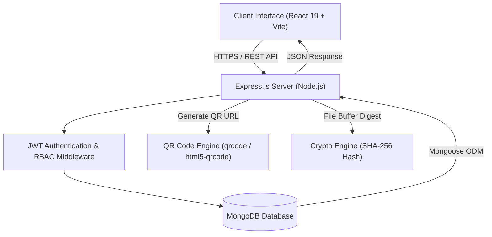

# 🎓 Digital Document Verification System — Final Project Report

**Project Title:** Digital Document Verification System  
**Technology Stack:** MERN (MongoDB, Express.js, React 19, Node.js)  
**Date of Submission:** October 10, 2026  
**Repository:** [https://github.com/visuachyu15-code/Digital_Document_verifier](https://github.com/visuachyu15-code/Digital_Document_verifier)

---

## 1. 📌 Executive Summary & Abstract

Traditional paper-based document verification (academic marksheets, degree certificates, national identity proofs) is prone to forgery, manual processing delays, and high administrative overhead. 

The **Digital Document Verification System** is a full-stack MERN web application engineered to solve document fraud. Every document registered in the system receives an auto-generated unique ID (e.g. `DOC-37DCD695B1`), a scannable **QR code**, and a cryptographic **SHA-256 file signature**. Anyone can scan the QR code or enter the document ID on the public portal to verify its authenticity in real time without creating an account or logging in.

### Key Highlights:
- **Role-Based Access Control (RBAC):** Granular permissions for **Admin**, **Verifier**, and **User** roles.
- **Cryptographic File Integrity:** SHA-256 hashing detects any file tampering or altered PDF copies.
- **On-Demand PDF Certificates:** Generates branded, scannable PDF certificates with embedded QR codes.
- **Public Verification & Camera QR Scanner:** In-browser live camera QR scanning using `html5-qrcode`.
- **Immutable Audit Trail:** Complete audit logging tracking every creation, update, and status review with timestamps.
- **Rate Limiting Protection:** DDoS and brute-force protection using `express-rate-limit`.

---

## 2. 🏗️ System Architecture & Data Flow



### Data Flow Steps:
1. **Registration/Upload:** User or Admin submits document metadata and optional file via `POST /api/documents`.
2. **Hash & ID Assignment:** Backend computes SHA-256 hash of file buffer and assigns a unique `DOC-XXXXXXXXXX` identifier.
3. **QR Encoding:** Server encodes `http://localhost:5173/verify/<documentId>` into a PNG Data URL via the `qrcode` library.
4. **Review & Approval:** Verifier/Admin reviews document details and updates status (`Verified`, `Rejected`, `Revoked`).
5. **Public Verification:** Anyone accesses `GET /api/verify/<documentId>` or scans the QR code using device camera to receive a real-time valid/invalid verdict.

---

## 3. 🗄️ Database Schemas (MongoDB / Mongoose)

### 3.1 User Schema (`User.js`)
| Field | Type | Options / Validation | Purpose |
|---|---|---|---|
| `_id` | ObjectId | Auto-generated | Primary Key |
| `name` | String | `required: true`, `trim: true` | Full user name |
| `email` | String | `required: true`, `unique: true`, `lowercase: true` | User email / Login handle |
| `password` | String | `required: true`, `minlength: 6`, `select: false` | Hashed password (bcrypt) |
| `role` | String | `enum: ['admin', 'verifier', 'user']`, `default: 'user'` | Access control role |
| `timestamps` | Date | `createdAt`, `updatedAt` | Auto timestamps |

### 3.2 Document Schema (`Document.js`)
| Field | Type | Options / Validation | Purpose |
|---|---|---|---|
| `documentId` | String | `unique: true`, `index: true` | Unique ID (e.g. `DOC-37DCD695B1`) |
| `documentName` | String | `required: true`, `trim: true` | Title of document (e.g. INTERMARKSHEET) |
| `documentType` | String | `required: true` | Category (Certificate, Marksheet, ID Proof) |
| `holderName` | String | `required: true` | Name of candidate/holder |
| `holderEmail` | String | `required: true` | Email of candidate/holder |
| `issuedBy` | String | `required: true` | Issuing authority/institution |
| `issueDate` | Date | `default: Date.now` | Date of issue |
| `expiryDate` | Date | `default: null` | Optional expiration date |
| `fileName` | String | `default: null` | Name of attached file |
| `fileHash` | String | `default: null` | Cryptographic SHA-256 file hash |
| `verificationStatus` | String | `enum: ['Pending', 'Verified', 'Rejected', 'Revoked']` | Status |
| `remarks` | String | `default: ''` | Verifier/reviewer notes |
| `verifiedBy` | ObjectId | `ref: 'User'`, `default: null` | User ID of verifier |
| `createdBy` | ObjectId | `ref: 'User'`, `required: true` | User ID of creator |
| `verificationCount` | Number | `default: 0` | Counter of public checks |
| `auditTrail` | Array | `[{ action, performedBy, details, timestamp }]` | Audit history log |

---

## 4. 🌐 Complete API Endpoint Reference

| Category | Method | Endpoint | Access | Description |
|---|---|---|---|---|
| **Health** | `GET` | `/api/health` | Public | System status health check |
| **Auth** | `POST` | `/api/auth/register` | Public | Register new user (always role 'user') |
| **Auth** | `POST` | `/api/auth/login` | Public | Authenticate & return JWT token |
| **Auth** | `GET` | `/api/auth/me` | Private | Get authenticated user profile |
| **Documents**| `GET` | `/api/documents` | Private | List documents with search & status filters |
| **Documents**| `POST` | `/api/documents` | Private | Create document (optional file upload) |
| **Documents**| `GET` | `/api/documents/:id` | Private | Fetch single document details |
| **Documents**| `GET` | `/api/documents/:id/qr` | Private | Generate QR code PNG Data URL |
| **Documents**| `PUT` | `/api/documents/:id` | Private | Edit pending document metadata |
| **Documents**| `DELETE` | `/api/documents/:id` | Private | Delete document (pending only for users) |
| **Documents**| `PATCH` | `/api/documents/:id/status` | Admin/Verifier | Update status (`Verified`/`Rejected`/`Revoked`) |
| **Documents**| `GET` | `/api/documents/stats` | Private | Get document status breakdown counts |
| **Documents**| `GET` | `/api/documents/charts` | Private | Get Recharts chart aggregation data |
| **Verify** | `GET` | `/api/verify/:documentId` | Public | Public verification result & payload |
| **Verify** | `POST` | `/api/verify/:documentId/check-file` | Public | SHA-256 file integrity check |
| **Users** | `GET` | `/api/users` | Admin | List all user accounts |
| **Users** | `PATCH` | `/api/users/:id/role` | Admin | Update user role |
| **Users** | `DELETE` | `/api/users/:id` | Admin | Delete user account (cannot self-delete) |

---

## 5. 👑 Role-Based Access Control (RBAC) Matrix

| Feature / Action | Admin | Verifier | User (Applicant) | Public Visitor |
|---|:---:|:---:|:---:|:---:|
| **Public Verification Lookup** | ✅ | ✅ | ✅ | ✅ |
| **Camera QR Scanning** | ✅ | ✅ | ✅ | ✅ |
| **SHA-256 File Hash Check** | ✅ | ✅ | ✅ | ✅ |
| **View Dashboard & Charts** | ✅ | ✅ | ✅ (Own docs only) | ❌ |
| **Create New Document** | ✅ (Direct Verified) | ✅ (Direct Verified) | ✅ (Pending only) | ❌ |
| **Edit Document** | ✅ (Any) | ❌ | ✅ (Pending own only) | ❌ |
| **Delete Document** | ✅ (Any) | ❌ | ✅ (Pending own only) | ❌ |
| **Review & Update Status** | ✅ | ✅ | ❌ | ❌ |
| **Download PDF Certificate** | ✅ | ✅ | ✅ (Verified only) | ❌ |
| **User Role Management** | ✅ | ❌ | ❌ | ❌ |

---

## 6. 🎓 Viva Voce Preparation (Questions & Answers)

### Q1: Why did you choose JWT for authentication?
**Answer:** JWT (JSON Web Tokens) provides stateless authentication. The server signs a cryptographically secure token containing user claims (`id`, `role`) upon login. The client attaches this token in the `Authorization: Bearer <token>` header for subsequent requests. This eliminates server-side session state and scales horizontally.

### Q2: How does role-based security work in Express.js?
**Answer:** We implemented two custom middleware functions:
1. `protect`: Extracts the JWT token from the Authorization header, verifies it using `jwt.verify()`, fetches the user object, and attaches it to `req.user`.
2. `authorize(...roles)`: Checks if `req.user.role` is included in the allowed roles array. If not, it halts execution and returns a `403 Forbidden` response.

### Q3: How is document file integrity verified using SHA-256?
**Answer:** When a document is uploaded, `multer` intercepts the file in memory. The Node.js `crypto` library computes a 256-bit hash (`crypto.createHash('sha256').update(file.buffer).digest('hex')`) and stores it in MongoDB. When a verifier uploads a copy, the system re-computes the hash and performs a constant-time comparison. If even a single byte or pixel is altered, the hashes will not match, detecting forgery immediately.

### Q4: What does the QR code contain?
**Answer:** The QR code encodes a full public verification URL (e.g. `http://localhost:5173/verify/DOC-37DCD695B1`). It does **not** contain raw document data. The real verification takes place server-side when the URL queries MongoDB to ensure status authenticity.

### Q5: How are passwords secured in the database?
**Answer:** Passwords are never stored as plain text. The User model uses a pre-save hook in Mongoose with `bcryptjs` (10 salt rounds) to hash the password before saving. During login, `bcrypt.compare()` compares the input password against the stored hash.

### Q6: Why is the `/api/verify/:documentId` route public?
**Answer:** The core objective of a document verification system is accessibility for employers, universities, and official agencies. The public endpoint returns non-sensitive validation details (Document ID, title, holder name, issuer, issue date, status, reviewer notes) while withholding creator IDs and user passwords.

### Q7: What is the purpose of rate limiting on the verify route?
**Answer:** We implemented `express-rate-limit` restricting IPs to **30 requests per minute**. This prevents malicious actors from brute-forcing or scraping document IDs (`DOC-XXXXXXXXXX`).

---

## 7. 🧪 Quality Assurance & Test Suite Summary

The application includes automated test suites validating all API endpoints, authentication boundaries, and edge cases across 4 phases:

```
==================================================
  PHASE 4 — FULL END-TO-END TEST SUITE
==================================================
▸ Health Check               (1/1 Passed)
▸ Authentication             (8/8 Passed)
▸ Document CRUD              (8/8 Passed)
▸ QR Code Generation         (1/1 Passed)
▸ Status Management          (5/5 Passed)
▸ Public Verification        (4/4 Passed)
▸ Audit Trail                (1/1 Passed)
▸ Role-Based Access Control  (3/3 Passed)
▸ User Management (Admin)    (4/4 Passed)
▸ Cleanup & Isolation        (3/3 Passed)
==================================================
  RESULTS: 38 passed, 0 failed, 38 total (100% PASS)
==================================================
```

---

## 8. 🚀 Setup & Execution Guide

### 1. Backend Setup:
```bash
cd server
npm install
npm run seed     # Seeds demo users & sample documents
npm run dev      # Starts Express server on http://localhost:5000
```

### 2. Frontend Setup:
```bash
cd client
npm install
npm run dev      # Starts Vite dev server on http://localhost:5173
```

---

## 🔑 Demo Login Credentials

| Role | Email | Password |
|---|---|---|
| **Admin** | `admin@demo.com` | `password123` |
| **Verifier** | `verifier@demo.com` | `password123` |
| **User** | `user@demo.com` | `password123` |

---

*Report prepared and generated for final project submission.*
